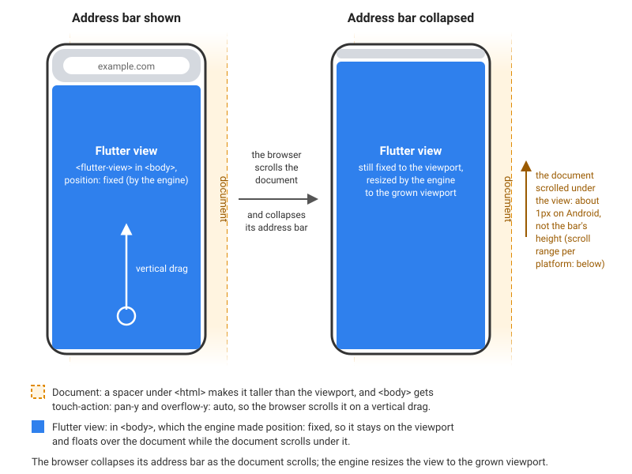
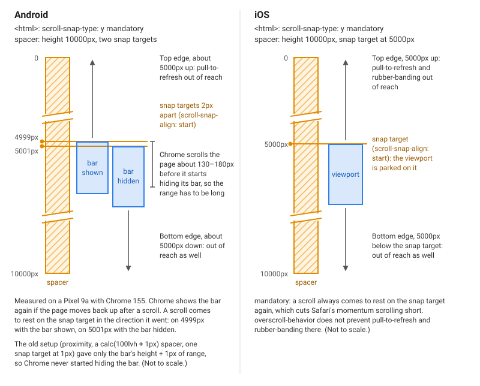
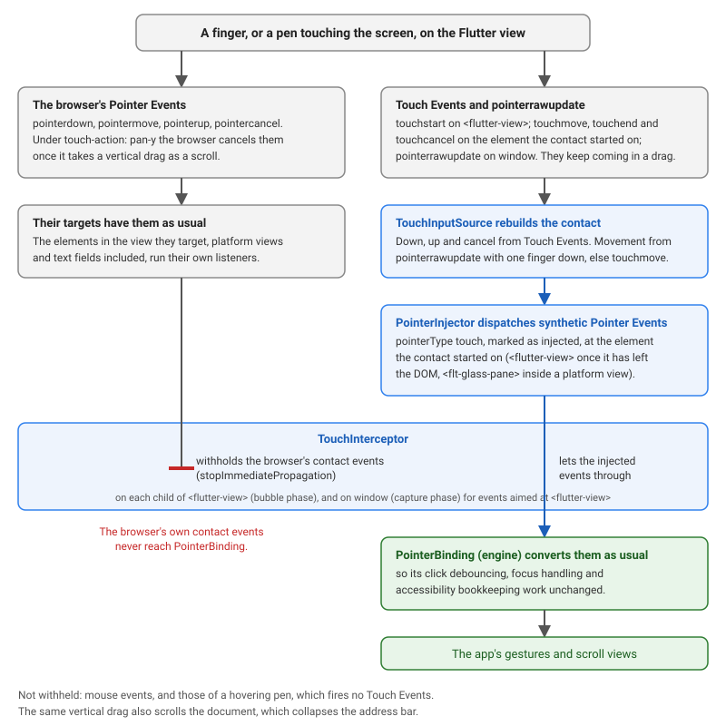

# web_address_bar

[](https://pub.dev/packages/web_address_bar)
[](https://github.com/koji-1009/web_address_bar/blob/main/LICENSE)
[](https://github.com/koji-1009/web_address_bar/actions/workflows/ci.yml)

Lets the mobile browser address bar collapse in full-page Flutter web apps on Android and iOS, while scrolling stays in Flutter's own scroll views.

## Why

A mobile browser collapses its address bar when the user scrolls the document. A full-page Flutter web app gives it nothing to scroll: the page is exactly as tall as the viewport, and `<body>` has `touch-action: none`, so every touch goes to Flutter.

This package gives the browser a document of its own to scroll, under a Flutter view that stays fixed, and rebuilds the touch input the browser then cancels.



## Usage

```dart
import 'package:web_address_bar/web_address_bar.dart';

void main() {
  WebAddressBar.enable();
  runApp(const MyApp());
}
```

`enable` can be called before or after `runApp`, but not while a finger is on the screen, such as from `onTapDown`: that touch would stay down. It takes effect in browsers on Android and iOS (iPadOS included); pass `platforms` to limit it, for example `WebAddressBar.enable(platforms: {TargetPlatform.iOS})`. Elsewhere it does nothing (see [Compatibility](#compatibility)). `WebAddressBar.isActive` tells whether it took effect, and in debug builds the reason it did not is printed. `WebAddressBar.disable()` undoes everything.

`WebAddressBar.collapsedExtent` is how much of the viewport the browser's UI covers, in logical pixels: the bar's height while it shows, 0 once it has collapsed.

### Scrolling to the top on a status bar tap (iOS)

Safari answers a tap on the iOS status bar by scrolling the document, which the package has taken over. Add `WebAddressBarScrollToTop` above the `Navigator` to scroll the primary scroll view in the foreground to the top instead, as a native iOS app does:

```dart
MaterialApp(
  builder: (context, child) => WebAddressBarScrollToTop(child: child!),
  // ...
);
```

Only a scroll view in the foreground is scrolled: a page under another route or a dialog, and hidden tabs, such as those an `IndexedStack` or an `Offstage` does not show, are left alone.

## How it works

On Android and iOS, when Flutter owns the whole page:

1. `<body>` gets `touch-action: pan-y`, so the browser reads a vertical drag as a scroll. `<body>` stays `position: fixed`, so the app does not move.
2. A 10000px spacer under `<html>` gives the document a scroll range, and `scroll-snap-type: y mandatory` keeps it parked in the middle, out of reach of pull-to-refresh and rubber-banding.
   - Android: two snap points, at 5000px and 5001px. Chrome scrolls some way before it hides its bar and shows it again on a scroll back up, so a scroll rests on the snap point in the direction it went.
   - iOS: one snap point, at 5000px.
3. Under `pan-y` the browser cancels the touch Pointer Events mid-drag, so the touch input is rebuilt from Touch Events and `pointerrawupdate` and handed to the engine as touch Pointer Events, which it handles as usual. Platform views and text fields still get the browser's own events first.





Based on [flutter/flutter#184281](https://github.com/flutter/flutter/pull/184281).

## Compatibility

- Flutter 3.50 or later, including the 3.50.0 prereleases on the beta channel. Earlier versions do not get the effect. It takes effect on the web, compiled to JavaScript or WebAssembly, and does nothing on other platforms, so an app for several platforms can call it as is.
- Takes effect only for a full-page app with the implicit view (no custom `hostElement`, no multi-view) with `<flutter-view>` under `<body>`. It does nothing if the page already scrolls itself: `touch-action` other than `none` on `<body>`, `overflow` changed on `<html>` or `<body>`, or a document taller than the viewport.
- Engines without [flutter/flutter#194109](https://github.com/flutter/flutter/pull/194109) can remove the accessibility placeholder in the middle of a drag that started on it. The package follows a contact on the element it started on, so the drag still ends.
- With semantics enabled, the engine gives its scrollable semantics nodes `touch-action: none`, so that the framework handles their scrolling ([`semantics/scrollable.dart`](https://github.com/flutter/flutter/blob/3.50.0-0.2.pre/engine/src/flutter/lib/web_ui/lib/src/engine/semantics/scrollable.dart#L155-L164)). A drag that starts on one does not collapse the bar.

## Limitations

- The browser does not report a status bar tap. It is inferred from a scroll toward the top with no finger on the screen.
- Touch input carries no pressure or tilt. A pen on the screen arrives as a touch; a hovering pen is reported as a stylus as usual. The movement of a pen, or of more than one finger, follows the browser's throttled `touchmove`. Apps that need pressure or tilt should not enable the package.
- Pull-to-refresh of the page is unavailable by design.

## Example

Try it on a phone:

- JavaScript: <https://koji-1009.github.io/web_address_bar/>
- WebAssembly: <https://koji-1009.github.io/web_address_bar/wasm/> (in Chrome; other browsers fall back to JavaScript)

[example/](example/) has test screens for lists, nested scrollables, interactive widgets, a page that does not scroll, sliver app bars, tabs, pull to refresh, pinch, a platform view, turning the package off and on, `collapsedExtent` and the long-drag repro of [flutter/flutter#194104](https://github.com/flutter/flutter/issues/194104), with what to check on a device.

## License

MIT.
